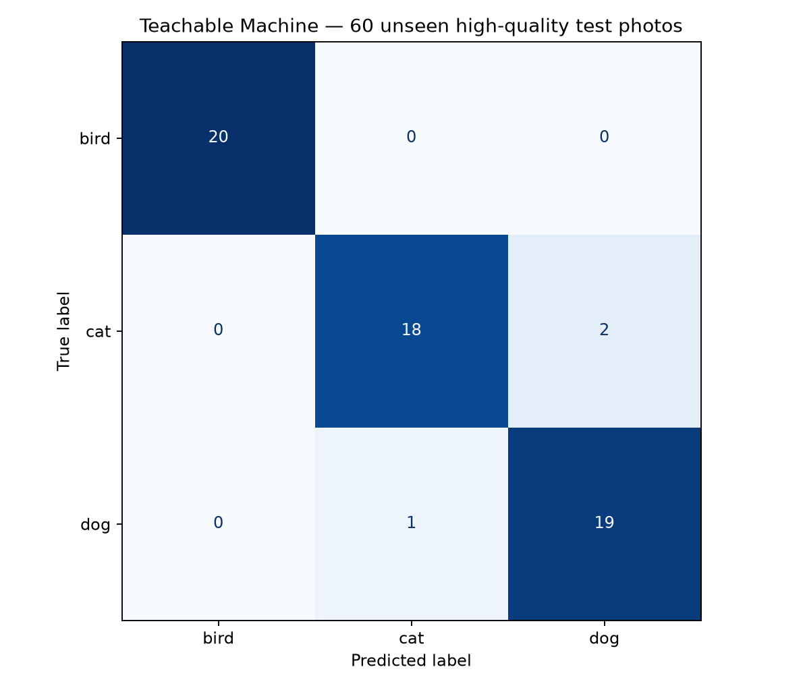

# Лабораторная работа

**Дисциплина:** Интеллектуальные системы  
**Кафедра:** Информационных систем и технологий  
**Тема:** Разработка системы компьютерного зрения для классификации изображений с использованием transfer learning  
**Выполнил:** Тимофеев Роман Сергеевич  
**Группа:** **141**  
**Дата:** 14 октября 2026 года

---

# 1. Цель работы

Цель моей работы — освоить переносное обучение (transfer learning), исследовать предобученные модели компьютерного зрения, подготовить наборы данных, обучить классификатор и проверить его на независимых изображениях. В ходе лабораторной реализованы два самостоятельных эксперимента: опубликованный веб-проект Google Teachable Machine и собственная программная реализация MobileNetV2 на Python/TensorFlow. Для обоих экспериментов сохранены проверяемые результаты.

**Важно:** источники данных у экспериментов различаются. Для Teachable Machine используются фотографии более высокого качества, для собственной модели — официальный CIFAR-10. Их процентные результаты нельзя напрямую использовать как доказательство превосходства одной платформы.

# 2. Теория и выбор архитектуры

Transfer learning — метод, при котором знания сети, заранее обученной на большом наборе (например, ImageNet), переносятся на новую задачу. Базовые сверточные слои извлекают универсальные визуальные признаки, а новый классификационный блок обучается на выбранных категориях. Такой подход экономит вычислительные ресурсы и пригоден для сравнительно небольших выборок.

| Архитектура | Основные особенности | Оценка применимости |
|:--|:--|:--|
| ResNet50 | Остаточные связи; высокая выразительная способность | Больше вычислительных затрат |
| VGG16 | Простая последовательная архитектура | Много весов и высокий расход памяти |
| EfficientNet | Эффективное масштабирование архитектуры | Требуется выбирать подходящий вариант |
| **MobileNetV2** | Лёгкие инвертированные остаточные блоки, depthwise convolutions | **Выбрана для CPU и экономии ресурсов** |

Я остановился на MobileNetV2 как компромиссе скорости и точности. Это **теоретическое сравнение** архитектур: отдельного экспериментального обучения всех четырёх сетей не проводилось.

# 3. Этап 1 — подготовка данных

## 3.1. Набор фотографий для Teachable Machine

Подготовлены три категории: **bird (птицы), cat (кошки), dog (собаки)**. На каждую категорию приходится 100 фотографий. Данные предварительно разделены на `train` (обучение) и `test` (тестирование) в соотношении **80/20**.

| Класс | Обучение | Тест | Всего |
|:--|--:|--:|--:|
| bird | 80 | 20 | 100 |
| cat | 80 | 20 | 100 |
| dog | 80 | 20 | 100 |
| **Итого** | **240** | **60** | **300** |

Для птиц взяты фотографии из **Caltech-UCSD Birds-200-2011**, для кошек и собак — из набора **Sijuade/Cats-Dogs-Birds**. Ранее использовавшиеся изображения CIFAR-10 с разрешением 32×32 оказались недостаточно качественными для наглядного веб-проекта, поэтому были заменены исходными фотографиями более высокого разрешения. В архиве есть `manifest.csv` с исходными URL и SHA-256. Повторное увеличение 32×32 пикселей не использовалось.

**Архив:** [Датасет_Птицы_Кошки_Собаки_80-20.zip](../02_Dataset/Датасет_Птицы_Кошки_Собаки_80-20.zip). Источники также указаны в [описании датасета](../02_Dataset/Источники_и_разделение.md).

## 3.2. CIFAR-10 для собственной модели

Из официального датасета CIFAR-10 выбраны классы с индексами 2, 3, 5 — **bird, cat, dog**. Для обучения использованы **4500 изображений** из train CIFAR-10 с разделением на **3600 train + 900 validation (80/20)**. Независимое тестирование проводилось на **3000 изображениях** из отдельной официальной тестовой выборки (по 1000 на класс). Эти 3000 изображений не использовались для подгонки весов.

# 4. Этап 2 — обучение в Teachable Machine

В интерфейсе Google Teachable Machine создан проект с тремя классами. Загружено по **80 фотографий** в каждый класс, выполнено обучение и публикация.

**Ссылка на опубликованную модель:**  
**https://teachablemachine.withgoogle.com/models/rPbqmrUgK/**

| Параметр | Зафиксированное значение | Комментарий |
|:--|:--|:--|
| Epochs | 25 | Значение настройки в интерфейсе |
| Batch Size | 16 | Малые пакеты при 240 изображениях |
| Learning Rate | 0,001 | Настройка скорости обучения |
| Классы | bird, cat, dog | Три категории из задания |
| Регуляризация | Не документирована | Дополнительные настройки не подтверждены |

После публикации доступность веб-модели проверена автоматически: обнаружены `metadata.json`, `model.json` и файл весов. Метки в метаданных соответствуют заданным категориям. Доказательство: [файл проверки модели](../03_Teachable_Machine/01_Проверка_публикации.json), [GitHub Actions — успешная проверка](https://github.com/mythical-crypto/university-notes/actions/runs/38575228344).

**Ограничение:** фактическое время обучения в веб-интерфейсе, конечные показатели **training accuracy / training loss** и динамика по эпохам не были записаны. Их нельзя подменять метриками на тестовой выборке.

## 4.1. Независимое тестирование Teachable Machine

Для теста взяты **60 фотографий из отдельной папки `test`** (по 20 на класс). Ни одно из этих изображений не было добавлено в обучающие 240. Проверка воспроизводимо выполнена скриптом через опубликованный веб-классификатор; для каждого изображения сохранена тройка вероятностей, выбранный класс и фактическая метка.

| Метрика тестирования | Подтверждённое значение |
|:--|--:|
| **Test Accuracy** | **95,00% (57 из 60)** |
| Macro Precision | 95,07% |
| Macro Recall | 95,00% |
| Macro F1-score | 95,00% |
| Multiclass log-loss | 0,09558 |

{width=12cm}

По классам: птицы — **20/20**, кошки — **18/20**, собаки — **19/20**. Ошибки: две кошки определены как собаки, одна собака — как кошка. Матрица ошибок (строки — истинные классы, столбцы — предсказания, порядок `bird, cat, dog`): `[[20,0,0],[0,18,2],[0,1,19]]`.

Подтверждение: [метрики JSON](../03_Teachable_Machine/02_Метрики_60_фото.json), [CSV всех 60 предсказаний](../03_Teachable_Machine/03_Предсказания_60_фото.csv), [GitHub Actions — успешный тест](https://github.com/mythical-crypto/university-notes/actions/runs/38575698894). Значение 0,09558 является **тестовым log-loss**, не показателем loss в последней эпохе обучения.

# 5. Этап 3 — собственная разработка на MobileNetV2

Для программной реализации применён **Python 3.11**, библиотека **TensorFlow 2.19.1**, NumPy, scikit-learn, Matplotlib, Pillow. Обучение успешно проведено на **CPU в GitHub Actions**. Точные параметры виртуальной машины (vCPU, объём RAM и диска) не документировались — их значения не придумываются.

## 5.1. Архитектура и параметры

Построена схема:

`Input 96×96×3 → аугментация → нормализация → MobileNetV2 (ImageNet, заморожена) → GlobalAveragePooling2D → Dense(128, ReLU) → Dropout(0.3) → Dense(3, softmax)`.

Параметры: **optimizer Adam**, **learning rate 0,001**, **batch size 32**, **8 выполненных эпох**, **validation split 20%**, базовые слои **заморожены**. Использованы операции предобработки и аугментации изображений.

| Метрика | Train | Validation |
|:--|--:|--:|
| Accuracy | **92,06%** | **85,33%** |
| Loss | **0,20045** | **0,32543** |

Измеренное время непосредственного обучения: **69,44 секунды**. Установка библиотек и подготовка среды в это время не входят. [Успешный запуск GitHub Actions](https://github.com/mythical-crypto/university-notes/actions/runs/38549153693).

## 5.2. Результаты независимого теста CIFAR-10

| Метрика | Подтверждённое значение |
|:--|--:|
| **Test Accuracy** | **86,30%** |
| Macro Precision | 86,26% |
| Macro Recall | 86,30% |
| Macro F1-score | 86,27% |
| Объём тестовой выборки | 3000 изображений |

{width=12cm}

Матрица ошибок: `[[922,52,26],[63,803,134],[24,112,864]]`. Лучший класс по Recall — **bird (92,20%)**, самый сложный — **cat (80,30%)**. Главные ошибки: **134 кошки распознаны как собаки**, **112 собак — как кошки**.

Модель сохранена в формате **H5**. Дополнительно сохранены графики обучения, матрица ошибок, classification report, примеры ошибок, исходный код и Jupyter Notebook. Файлы: [H5-модель](../04_MobileNetV2/01_Модель_MobileNetV2_CIFAR10.h5), [точные метрики](../04_MobileNetV2/02_Метрики_CIFAR10.json), [графики accuracy/loss](../04_MobileNetV2/04_Графики_обучения.png), [classification report](../04_MobileNetV2/05_Отчет_по_классам.txt), [ноутбук](../05_Source_Code/01_Ноутбук_CIFAR10.ipynb).

Кроме главного эксперимента в коде присутствует малый вспомогательный эксперимент Keras на CIFAR-10 (test accuracy 80,00% на 60 примерах). **Он не является Teachable Machine** и в итоговом сравнении основным результатом не считается.

# 6. Этап 4 — сравнение инструментов и публикация

| Критерий | Teachable Machine | Собственная MobileNetV2 |
|:--|:--|:--|
| Простота использования | Визуальный интерфейс | Необходимо писать и запускать код |
| Управление архитектурой | Ограничено возможностями сайта | Настраиваемые слои и режим обучения |
| Сохранение результатов | Публичная веб-модель | H5, Notebook, JSON и PNG |
| Независимый тест | 60 новых фотографий | 3000 изображений CIFAR-10 |
| Accuracy на своём тесте | **95,00%** | **86,30%** |
| Время обучения | Не зафиксировано | 69,44 секунды |

**Прямое сравнение 95,00% и 86,30% некорректно**: наборы данных и условия тестирования различаются. Цель таблицы — сравнить инструменты и зафиксировать результаты на каждом отдельном тесте.

## 6.1. Проблемы и решения

1. **Низкое исходное разрешение CIFAR-10 (32×32).** Для демонстрации в Teachable Machine я заменил фотографии отдельным качественным набором с сохранением классов и распределения 80/20.
2. **Ограниченные вычислительные ресурсы.** Для собственной реализации выбрал MobileNetV2 и заморозил предобученные слои; обучение выполнял на CPU.
3. **Похожие классы cat/dog.** По двум матрицам ошибок выделил наиболее частые пары неверных предсказаний и определил направление улучшения набора данных.

## 6.2. Возможные улучшения

1. Увеличить разнообразие снимков по освещению, фону и позам животных.
2. Выполнить fine-tuning части последних блоков MobileNetV2 с меньшим learning rate.
3. Сравнить обе модели на одной общей независимой выборке, дополнительно проверить обобщение на других источниках данных.

# 7. Проверка всех пунктов исходного задания

| Пункт оригинального бланка | Подтверждённый статус |
|:--|:--|
| Три класса; 50–100 изображений; 80/20 | **Выполнено** |
| Анализ предобученных архитектур, выбор | **Выполнено теоретически**; обучена MobileNetV2 |
| Teachable Machine: классы, параметры, обучение | **Выполнено** |
| Teachable Machine: опубликованная модель | **Выполнено**; ссылка проверена |
| Teachable Machine: Test Accuracy, Precision, Recall, F1 | **Выполнено**; 60 фото, Accuracy 95,00% |
| CIFAR-10, 3 класса, аугментация, своя архитектура | **Выполнено** |
| Обучение своей модели, H5, графики PNG, Notebook | **Выполнено** |
| Confusion matrix, classification report, ошибки | **Выполнено** |
| GitHub + отчёт | **Выполнено** |
| Google Drive: отдельная ссылка на датасет | **Не подтверждена**; архив доступен на GitHub |
| Google Colab: запуск именно в Colab | **Не подтверждён**; использован GitHub Actions |
| Yandex Datasphere: отдельный проект/ноутбук | **Не подтверждён** |
| Yandex Disk: экспорт результатов | **Не подтверждён** |
| Teachable Machine: время, конечные train accuracy/loss и графики по эпохам | **Не зафиксированы** |
| CPU: фактические vCPU, RAM и диск | **Не зафиксированы** |

Я не подменяю отсутствующие ссылки на указанные облачные сервисы вымышленными адресами. При требовании обязательной работы именно в Yandex Datasphere и Google Colab эти действия нужно выполнить отдельно либо согласовать использование GitHub Actions.

# 8. Состав комплекта для преподавателя

| Папка репозитория | Содержимое |
|:--|:--|
| `01_Report` | Отчёт Word, PDF, исходный текст |
| `02_Dataset` | ZIP с train/test, список источников и примеры |
| `03_Teachable_Machine` | Метрики, матрица, прогнозы и подтверждение публикации |
| `04_MobileNetV2` | H5-модель, метрики, графики, матрица, classification report |
| `05_Source_Code` | Jupyter Notebook, Python-скрипты обучения и проверки |
| `.github/workflows` | Настройки автоматического обучения и проверки |

**Основные публичные ссылки:**

- **Репозиторий:** https://github.com/mythical-crypto/university-notes
- **Teachable Machine:** https://teachablemachine.withgoogle.com/models/rPbqmrUgK/
- **Успешное обучение MobileNetV2:** https://github.com/mythical-crypto/university-notes/actions/runs/38549153693
- **Подтверждение публикации Teachable Machine:** https://github.com/mythical-crypto/university-notes/actions/runs/38575228344
- **Тест 60 фотографий Teachable Machine:** https://github.com/mythical-crypto/university-notes/actions/runs/38575698894

# 9. Вывод

В ходе выполнения лабораторной работы я подготовил два датасета для разных экспериментов, использовал transfer learning, обучил классификаторы и сохранил подтверждающие результаты. **Опубликованная Teachable Machine правильно классифицировала 57 из 60 новых фотографий (Accuracy 95,00%)**, а **MobileNetV2 с предобученной базой — 86,30% на официальных 3000 тестовых примерах CIFAR-10**. Репозиторий содержит модель H5, Jupyter Notebook, графики, матрицы ошибок, метрики и исходные данные. Оставшиеся требования о конкретных облачных платформах явно обозначены в разделе 7.

# 10. Источники

1. Исходное 11-страничное задание по дисциплине «Интеллектуальные системы».
2. CIFAR-10: https://www.cs.toronto.edu/~kriz/cifar.html
3. MobileNetV2 (Sandler et al.): https://arxiv.org/abs/1801.04381
4. TensorFlow Keras MobileNetV2: https://www.tensorflow.org/api_docs/python/tf/keras/applications/MobileNetV2
5. Google Teachable Machine: https://teachablemachine.withgoogle.com/
6. Caltech-UCSD Birds: https://huggingface.co/datasets/cassiekang/cub200_dataset
7. Cats-Dogs-Birds: https://huggingface.co/datasets/Sijuade/Cats-Dogs-Birds
8. Публичный репозиторий с результатами: https://github.com/mythical-crypto/university-notes