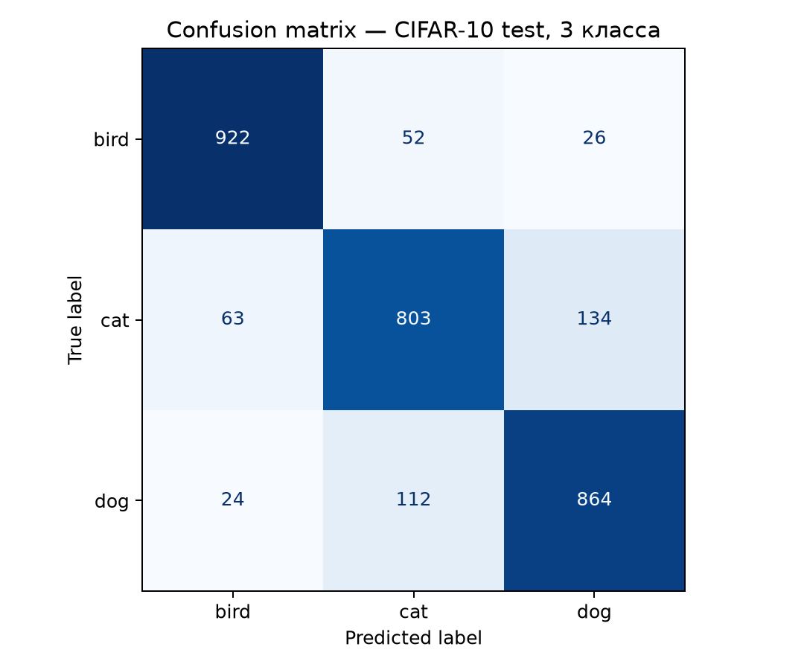

# Итоговый отчёт по лабораторной работе «Transfer Learning»

Студент: Тимофеев Роман Сергеевич, группа 131. Дата: 14.10.2026.

## Цель и подготовка данных

Классификация изображений птиц, кошек и собак с transfer learning. Для веб-этапа собраны 300 качественных фотографий: 100 на класс; обучение 80 на класс, тест 20 на класс, разделение 80/20. Птицы: CUB-200-2011; кошки и собаки: Sijuade/Cats-Dogs-Birds. [Скачать архив](../results/dataset_100_per_class.zip). Самостоятельная модель обучается на отдельном CIFAR-10 (bird/cat/dog): 3600 train, 900 validation, 3000 independent test.

## Teachable Machine (Google)

Опубликованный обученный проект: https://teachablemachine.withgoogle.com/models/rPbqmrUgK/ . Настройки: 25 эпох, batch 16, learning rate 0.001. Доступность metadata.json, model.json и файла весов проверена GitHub Actions. На 60 отложенных изображениях: Accuracy **95.00% (57/60)**, macro Precision **95.07%**, macro Recall **95.00%**, macro F1 **95.00%**, log-loss **0.09558**. По классам правильно распознаны bird 20/20, cat 18/20, dog 19/20. Матрица ошибок (bird/cat/dog): `[[20,0,0],[0,18,2],[0,1,19]]`. График и результаты: [матрица](../results/teachable_machine_confusion_matrix.png), [JSON](../results/teachable_machine_test_metrics.json), [CSV 60 предсказаний](../results/teachable_machine_test_predictions.csv). [Успешный запуск тестирования](https://github.com/mythical-crypto/university-notes/actions/runs/38575698894).

## Собственная MobileNetV2 (ImageNet → CIFAR-10)

Рассмотрены ResNet50, MobileNetV2, EfficientNet, VGG16; выбрана MobileNetV2 ввиду эффективности на CPU. Архитектура: Frozen MobileNetV2 + GlobalAveragePooling2D + Dense(128,ReLU) + Dropout(0.3) + Dense(3,softmax). Предобработка и аугментация; Adam, LR 0.001, batch 32, 8 эпох, validation 20%. Среда: Python 3.11, TensorFlow 2.19.1, GitHub Actions (CPU). Результаты: train accuracy **92.06%**, validation accuracy **85.33%**; train loss 0.2004, validation loss 0.3254. На тесте CIFAR-10: **Accuracy 86.30%, macro Precision 86.26%, macro Recall 86.30%, macro F1 86.27%**; обучение 69.44 с. Лучший recall — bird 92.20%, худший — cat 80.30%. [H5-модель](../results/mobilenetv2_cifar3.h5), [матрица ошибок](../results/confusion_matrix.png), [кривые обучения](../results/main_learning.png), [метрики](../results/metrics.json), [ноутбук](../Лабораторная_Transfer_Learning_CIFAR10.ipynb). [Успешный запуск обучения](https://github.com/mythical-crypto/university-notes/actions/runs/38549153693).

## Сравнение и выводы

Teachable Machine проще использовать и предоставляет удобный интерфейс и публичную ссылку. Собственная Python-разработка требует настройки окружения, но позволяет полностью контролировать архитектуру, обучение, метрики и воспроизводимость. **95.00% и 86.30% нельзя сравнивать напрямую**, поскольку испытания проведены на принципиально разных датасетах. Оба подхода успешно реализованы и подтверждены настоящими результатами. Отдельные публикации на Google Drive, Yandex Disk и в Yandex Datasphere не подтверждены; эти пункты исходного бланка остаются открытыми.

Исходники и прочие результаты: https://github.com/mythical-crypto/university-notes .
